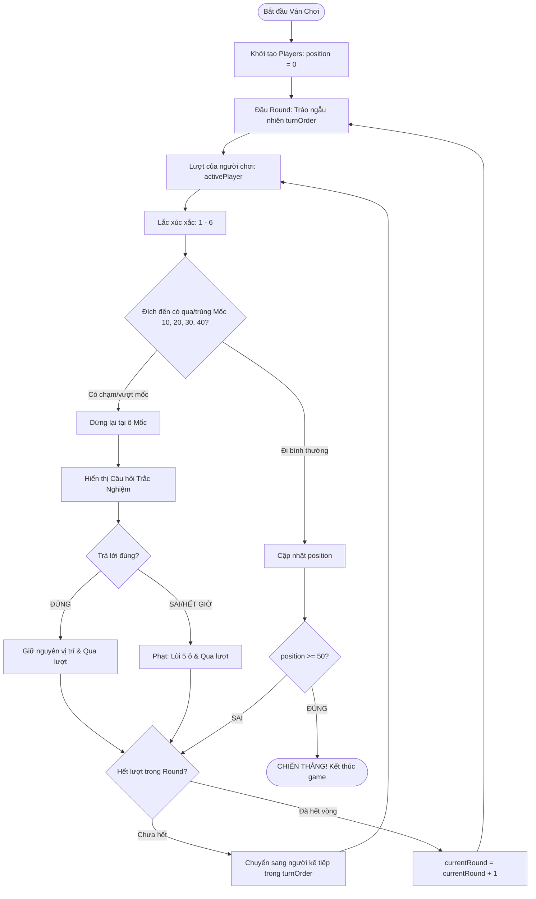

# TÀI LIỆU QUY ĐỊNH LUẬT & CẤU TRÚC DỮ LIỆU
# TRÒ CHƠI: "LEO ĐỈNH BÀN CỜ" (PEAK CLIMBER)

---

## 1. TỔNG QUAN TRÒ CHƠI (OVERVIEW)

- **Tên trò chơi**: Leo Đỉnh Bàn Cờ (Peak Climber).
- **Thể loại**: Board Game theo lượt (Turn-based), đua tiến độ kết hợp đố vui trắc nghiệm.
- **Số lượng người chơi**: 2 đến 4 người chơi (hỗ trợ chơi cùng trên 1 máy Pass & Play hoặc đấu với Bot).
- **Bàn cờ**: Gồm 51 ô số, đánh chỉ số từ `0` (vạch xuất phát) đến `50` (đỉnh chiến thắng).
- **Mục tiêu**: Người chơi đổ xúc xắc để leo bậc thang, vượt qua các mốc trắc nghiệm kiểm tra trí tuệ và là người đầu tiên chạm hoặc vượt mốc ô **50**.

---

## 2. CẤU TRÚC DỮ LIỆU CHUẨN (DATA STRUCTURES)

### 2.1. Đối tượng Người chơi (`Player`)
Mỗi người chơi tham gia ván đấu được định nghĩa bởi cấu trúc đối tượng:

```typescript
interface Player {
    id: string;             // Định danh duy nhất (ví dụ: 'player_1', 'bot_1')
    name: string;           // Tên hiển thị người chơi (ví dụ: "Chiến Binh Đỏ")
    color: string;          // Mã màu nhận diện HEX/CSS (ví dụ: "#ff0055", "#00f0ff")
    position: number;       // Vị trí hiện tại trên bàn cờ, phạm vi từ 0 đến 50
    isBot?: boolean;        // Cờ xác định có phải Bot AI hay không (mặc định: false)
    stats?: {
        correctAnswers: number; // Số câu hỏi trắc nghiệm trả lời đúng
        totalRolls: number;     // Tổng số lần đã lắc xúc xắc
    };
}
```

**Ví dụ dữ liệu JSON:**
```json
{
  "id": "p1",
  "name": "Hiệp Sĩ Xanh",
  "color": "#00f0ff",
  "position": 0,
  "isBot": false,
  "stats": {
    "correctAnswers": 0,
    "totalRolls": 0
  }
}
```

---

### 2.2. Trạng thái Toàn cục ván chơi (`GameState`)
Lưu trữ toàn bộ bối cảnh và tiến trình ván đấu tại mọi thời điểm:

```typescript
type GamePhase = 
    | 'SETUP'            // Thiết lập phòng, người chơi
    | 'ROUND_START'      // Bắt đầu vòng mới, chuẩn bị xáo trộn lượt
    | 'WAITING_ROLL'     // Đang chờ người chơi hiện tại đổ xúc xắc
    | 'MOVING'           // Đang thực hiện animation di chuyển trên bàn cờ
    | 'MILESTONE_QUIZ'   // Dừng tại mốc, đang hiển thị câu hỏi trắc nghiệm
    | 'GAME_OVER';       // Đã tìm ra người chiến thắng

interface GameState {
    boardLength: 50;                  // Vị trí đích là 50
    milestones: [10, 20, 30, 40];      // Các mốc kiểm tra trắc nghiệm
    players: Player[];                // Danh sách toàn bộ người chơi
    currentRound: number;             // Số thứ tự vòng đấu hiện tại (bắt đầu từ 1)
    turnOrder: string[];              // Mảng chứa ID người chơi theo thứ tự lượt của vòng hiện tại
    currentTurnIndex: number;         // Vị trí người chơi trong turnOrder (0 -> turnOrder.length - 1)
    activePlayerId: string;           // ID của người đang tới lượt đi
    lastDiceRoll: number | null;      // Giá trị xúc xắc vừa đổ (1 đến 6)
    currentQuiz: QuizQuestion | null; // Dữ liệu câu hỏi đang hiển thị (nếu đang ở mốc)
    phase: GamePhase;                 // Trạng thái điều hướng giao diện
    winner: Player | null;            // Người chơi chiến thắng (khi vị trí >= 50)
}
```

---

### 2.3. Cấu trúc Câu hỏi Trắc nghiệm (`QuizQuestion`)

```typescript
interface QuizQuestion {
    id: number | string;      // ID câu hỏi
    milestone: number;        // Mốc gắn liền (10, 20, 30 hoặc 40)
    question: string;         // Nội dung câu hỏi
    options: string[];        // 4 phương án lựa chọn (A, B, C, D)
    correctIndex: number;     // Vị trí đáp án đúng (0, 1, 2, 3)
    timeLimitSeconds?: number;// Thời gian giới hạn trả lời (mặc định 15s)
}
```

---

## 3. QUY TẮC & LUẬT CHƠI CHI TIẾT (GAMEPLAY RULES)

### 3.1. Vạch Xuất phát & Bản đồ 5 Tầng Đèo Sơn Trà
- Tất cả người chơi khởi đầu tại vị trí **`position = 0`** (Chân núi).
- Bàn cờ gồm 51 ô số (0 đến 50) xếp hình ziczac như cầu thang lên 5 tầng đèo núi Sơn Trà:
  - **Tầng 1 (Ô 0 ➔ 10)**: Chân núi Sơn Trà & Bãi Bụt. Dừng chân tại **Mốc 10** (Xanh Ngọc • Chùa Linh Ứng).
  - **Tầng 2 (Ô 11 ➔ 20)**: Đoạn đèo Linh Ứng Tự. Dừng chân tại **Mốc 20** (Vàng Hổ Phách • Cây Đa Di Sản).
  - **Tầng 3 (Ô 21 ➔ 30)**: Đoạn đèo Cây Đa Di Sản. Dừng chân tại **Mốc 30** (Tím Neon • Trạm Ra-đa Mắt Thần Đông Dương).
  - **Tầng 4 (Ô 31 ➔ 40)**: Đoạn dốc Mây & Gió. Dừng chân tại **Mốc 40** (Đỏ Hồng Ruby • Dốc Mây Đèo Gió).
  - **Tầng 5 (Ô 41 ➔ 50)**: Chinh phục **Đỉnh Bàn Cờ** (Hoàng Kim • Tượng Tiên Ông Đế Thích đánh cờ).

### 3.2. Hệ thống Vòng & Lượt (Round & Turn System)
- **Quy tắc Tráo lượt ngẫu nhiên**:
  - Mỗi khi kết thúc một chu kỳ mà tất cả người chơi đều đã đi xong (hết 1 Round), hệ thống sẽ tăng `currentRound` lên 1.
  - Ngay đầu mỗi Round mới, danh sách người chơi sẽ được **xáo trộn ngẫu nhiên hoàn toàn (Fisher-Yates Shuffle)** để tạo thành mảng thứ tự đi mới (`turnOrder`).
  - **Mục đích**: Triệt tiêu lợi thế cố định của người đi trước (First-player advantage), tạo tính bất ngờ và cân bằng cạnh tranh.
- **Lượt chơi đơn lẻ & Hiệu ứng Khối Lập Phương True 3D (Tumbling 3D Dice Roll Physics)**:
  - Khi người chơi bấm nút **Tung xúc xắc**:
    1. Hiển thị lớp phủ **Overlay làm mờ nhẹ màn hình** (`backdrop-filter: blur(8px)`).
    2. Khối lập phương **True 3D Cube** (`perspective: 900px`, `perspective-origin: 50% 28%`, `transform-style: preserve-3d`, kích thước 120x120px) đặt ở chính giữa màn hình với 6 mặt vuông kín khít (`translateZ(60px)`), nền trắng ngà, bo góc 16px, đổ bóng viền nổi khối `inset box-shadow` và ánh sáng định hướng chân thực trên từng mặt.
    3. Các chấm tròn đỏ tươi truyền thống (mặt 1 chấm cực đại 42px, mặt 4 chấm to 25px nổi bật).
    4. **Hoạt ảnh nhào lộn 3D 6 mặt & nảy tiếp đất sống động (60fps requestAnimationFrame)**:
       - **Giai đoạn Tung bổng (0 - 60%)**: Xúc xắc được tung bổng lên không trung (-110px) và xoay tít tự do đa trục đồng thời trên cả 3 trục $X$ (4 vòng), $Y$ (3 vòng) và $Z$ (2 vòng), hiển thị lật chuyển động 6 mặt liên tục trong không gian 3 chiều.
       - **Giai đoạn Tiếp đất & Nảy (60% - 100%)**: Rơi xuống mặt bàn tạo va chạm âm thanh, nảy 2 nấc liên tiếp (-32px và -8px), bóng tiếp đất mở rộng/thu hẹp theo độ cao.
       - **Giai đoạn Dừng & Khớp kết quả**: Giảm tốc mượt mà với đường cong Quartic Ease Out, khớp chính xác mặt trúng hướng về người xem với góc nhìn 3D trực quan, scale bounce nhẹ.
    5. Sau khi dừng xoay, giữ nguyên trên màn hình **0.8 giây** kèm badge thông báo số bước để người chơi nhìn rõ số chấm, sau đó ẩn lớp phủ và bắt đầu di chuyển quân cờ.
  - Vị trí dự kiến = `position + diceRoll`.

---

### 3.3. Cơ chế Mốc Thử Thách (Milestone Mechanism: 10, 20, 30, 40)
Bàn cờ có 4 trạm gác đặc biệt tại các ô số: **10, 20, 30, 40**.

#### Quy định kích hoạt mốc:
1. **Dừng chân trúng mốc (Landing on Milestone)**:
   - Nếu `position + diceRoll == Milestone`: Người chơi di chuyển đến ô mốc và **bắt buộc** phải trả lời câu hỏi trắc nghiệm của mốc đó.
2. **Vượt qua mốc (Passing Milestone)**:
   - *Luật dừng lại kiểm tra*: Nếu vị trí ban đầu nằm trước mốc và nước đi của xúc xắc làm người chơi nhảy vượt qua mốc (`position < M` và `position + diceRoll > M`):
     - Người chơi **bị chặn dừng chân lại ngay tại ô Mốc `M`** trong lượt này để làm bài kiểm tra. Số điểm xúc xắc dư thừa sẽ bị huỷ bỏ.
3. **Quy tắc 1 Lần Duy Nhất & Không Trùng Lặp**:
   - **Kích hoạt 1 lần duy nhất**: Mỗi mốc (10, 20, 30, hoặc 40) chỉ kích hoạt câu hỏi đúng **1 lần duy nhất** cho mỗi người chơi. Nếu người chơi bị phạt lùi bước và đi qua lại mốc đã từng chạm, mốc đó sẽ **không** bị kích hoạt lại.
   - **Kho câu hỏi không trùng lặp**: Hệ thống gồm 20 câu hỏi trắc nghiệm về **Đại học Bách khoa - Đại học Đà Nẵng (DUT)**. Câu hỏi nào đã xuất hiện sẽ được đưa vào danh sách loại trừ và **không bao giờ lặp lại** trong suốt ván đấu.

#### Quy định kết quả Trắc nghiệm:
- **Trả lời ĐÚNG**:
  - Người chơi vượt qua thử thách thành công.
  - **Giữ nguyên vị trí** tại ô Mốc và **kết thúc lượt (qua lượt)**, chuyển sang người chơi kế tiếp trong `turnOrder`.
- **Trả lời SAI hoặc HẾT GIỜ**:
  - Người chơi bị phạt: **Lùi lại 5 ô** (`position = Math.max(0, Milestone - 5)`) và **kết thúc lượt (qua lượt)** ngay lập tức.

---

### 3.4. Điều Kiện Thắng (Win Condition)
- **Luật về đích**: Người chơi đầu tiên có vị trí **`position >= 50`** sẽ:
  1. Trở thành **Người Chiến Thắng (WINNER)** ngay lập tức.
  2. Ván đấu kết thúc ngay tại thời điểm đó (`phase = 'GAME_OVER'`), không cần chờ các người chơi còn lại hoàn thành hết lượt của Round.
  3. Màn hình trao cúp vinh danh cùng bảng tổng kết thành tích được hiển thị.

---

## 4. SƠ ĐỒ LUỒNG HOẠT ĐỘNG (GAME FLOW)



---

## 5. BẢNG TỔNG HỢP CÁC SỰ KIỆN HỆ THỐNG (STATE EVENTS)

| Sự Kiện (Event Action) | Đầu Vào (Payload) | Mô Tả Xử Lý |
| :--- | :--- | :--- |
| `START_GAME` | `{ playerNames: string[] }` | Tạo danh sách người chơi, đặt `position = 0`, chuyển sang `ROUND_START`. |
| `SHUFFLE_ROUND` | Không có | Thuật toán Fisher-Yates xáo trộn `turnOrder`, đặt `currentTurnIndex = 0`. |
| `ROLL_DICE` | Không có | Random 1 - 6, tính toán ô đích đến và kiểm tra điều kiện mốc/thắng. |
| `ANSWER_QUIZ` | `{ answerIndex: number }` | So khớp với `correctIndex`: ĐÚNG giữ vị trí & qua lượt; SAI/HẾT GIỜ lùi 5 ô (`max(0, pos - 5)`) & qua lượt. |
| `NEXT_TURN` | Không có | Tăng `currentTurnIndex`. Nếu vượt qua danh sách thì kích hoạt `SHUFFLE_ROUND` mới. |
| `TRIGGER_WIN` | `{ winnerId: string }` | Chuyển trạng thái sang `GAME_OVER`, kích hoạt pháo hoa và bảng kết quả. |

---

*Tài liệu này là đặc tả chuẩn duy nhất (Single Source of Truth) để đội ngũ lập trình triển khai logic cho trò chơi **"Leo Đỉnh Bàn Cờ"**.*

